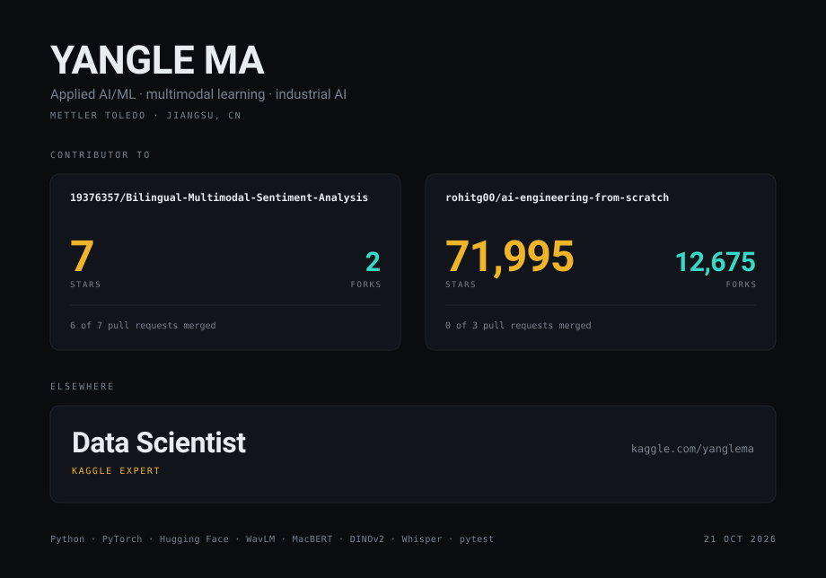

<a href="https://github.com/search?q=author%3AMaYangle+is%3Apr+is%3Amerged+is%3Apublic+-user%3AMaYangle&type=pullrequests"><picture>
  <source media="(max-width: 600px)" srcset="assets/sheet-mobile.svg">
  
</picture></a>

[19376357/Bilingual-Multimodal-Sentiment-Analysis](https://github.com/19376357/Bilingual-Multimodal-Sentiment-Analysis) · [rohitg00/ai-engineering-from-scratch](https://github.com/rohitg00/ai-engineering-from-scratch) · [Kaggle](https://www.kaggle.com/yanglema) · [LinkedIn](https://www.linkedin.com/in/yangle-ma-84877a294/) · [Email](mailto:yanglema44@gmail.com)
