<h1 align="center">Yangle Ma</h1>

<b>Multimodal AI · Open Source · Reproducible Research</b>

&nbsp; &nbsp; 

<a href="https://www.linkedin.com/in/yangle-ma-84877a294/">LinkedIn</a> · <a href="mailto:yanglema44@gmail.com">Email</a>

I build multimodal learning systems and study how text, audio, and vision combine under careful, reproducible evaluation. I value controlled comparisons, honest results, and practical reliability fixes in the open-source projects I use.

---

## Featured research

### [Multimodal Sentiment Fusion](https://github.com/MaYangle/Multimodal-Sentiment-Fusion)

Research on multimodal sentiment analysis and fusion algorithms with native CH-SIMS v2 and CMU-MOSEI evaluation protocols.

Text · Audio · Vision  →  **Multimodal fusion**  →  Sentiment prediction

[Architecture](https://github.com/MaYangle/Multimodal-Sentiment-Fusion/blob/main/docs/ARCHITECTURE.md) · [Experiments](https://github.com/MaYangle/Multimodal-Sentiment-Fusion/blob/main/docs/EXPERIMENTS.md) · [Reproduce](https://github.com/MaYangle/Multimodal-Sentiment-Fusion/blob/main/docs/REPRODUCING.md)

New public, non-fork repositories with content are discovered automatically on the next six-hour refresh.

## Research snapshot

**2026-10-14 · CH-SIMS v2.0 · 27 completed fits · 3 seeds**

CH-SIMS v2.0 sequence-routing study: 27/27 fits completed, including 21 fusion fits across 7 arms and 3 seeds.

| Validation arm | VALID MAE ↓ |
| --- | ---: |
| Distilled post-normalization candidate | 0.378497 ± 0.007455 |
| Matched distilled-static control | 0.378253 ± 0.008851 |

Development VALID only; native clipped MAE, lower is better. Mean ± sample SD over seeds 13 / 42 / 2026. Final TEST remains independent.

The candidate did not pass the preregistered promotion gate; a consistent routing gain has not been established. [Methods and full results](https://github.com/MaYangle/Multimodal-Sentiment-Fusion/blob/main/docs/EXPERIMENTS.md).

**Next:** Open research gates: fresh full repetition, author-media verification, native MOSEI method replication and final TEST evaluation.

## What I work on

| Area | Current focus |
| --- | --- |
| [Multimodal fusion](https://github.com/MaYangle/Multimodal-Sentiment-Fusion/blob/main/docs/ARCHITECTURE.md) | Frozen text, audio and vision features; masked sequence fusion and modality routing. |
| [Evaluation &amp; ablations](https://github.com/MaYangle/Multimodal-Sentiment-Fusion/blob/main/docs/EXPERIMENTS.md) | Matched controls, native dataset protocols and three-seed comparisons; negative results retained. |
| [Training systems](https://github.com/MaYangle/Multimodal-Sentiment-Fusion/blob/main/docs/REPRODUCING.md) | Source-isolated selection, checkpoint resume, seeded runs and independent replay. |

## Open-source contributions

**[Bilingual Multimodal Sentiment Analysis](https://github.com/19376357/Bilingual-Multimodal-Sentiment-Analysis)** — Fixed missing-face features, single-sample output handling and non-finite predictions; added English and Chinese README documentation.

[Reliability fixes · merged PR \#7](https://github.com/19376357/Bilingual-Multimodal-Sentiment-Analysis/pull/7) · [Documentation · merged PR \#5](https://github.com/19376357/Bilingual-Multimodal-Sentiment-Analysis/pull/5)

### Recent pull requests

| Updated | Pull request | Status |
| --- | --- | --- |
| 2026-10-10 | [rohitg00/ai-engineering-from-scratch \#583 — feat(quizzes): backfill 150 missing lesson quizzes](https://github.com/rohitg00/ai-engineering-from-scratch/pull/583) | Open |
| 2026-10-09 | [rohitg00/ai-engineering-from-scratch \#531 — docs(i18n): complete and audit 12 README translations](https://github.com/rohitg00/ai-engineering-from-scratch/pull/531) | Closed without merge |
| 2026-10-04 | [rohitg00/ai-engineering-from-scratch \#527 — Research links for seven lessons](https://github.com/rohitg00/ai-engineering-from-scratch/pull/527) | Open |
| 2025-08-31 | [19376357/Bilingual-Multimodal-Sentiment-Analysis \#7 — Training and inference edge-case fixes](https://github.com/19376357/Bilingual-Multimodal-Sentiment-Analysis/pull/7) | Merged |
| 2025-08-31 | [19376357/Bilingual-Multimodal-Sentiment-Analysis \#6 — Solve train and](https://github.com/19376357/Bilingual-Multimodal-Sentiment-Analysis/pull/6) | Closed without merge |
| 2025-08-27 | [19376357/Bilingual-Multimodal-Sentiment-Analysis \#5 — English and Chinese documentation](https://github.com/19376357/Bilingual-Multimodal-Sentiment-Analysis/pull/5) | Merged |

## Latest project activity

- 2026-10-14 · [MaYangle/Multimodal-Sentiment-Fusion](https://github.com/MaYangle/Multimodal-Sentiment-Fusion) · [Record verified Linux CI and explain scientific audit gate failures](https://github.com/MaYangle/Multimodal-Sentiment-Fusion/commit/74608094ea55b6f9aaa896831796105e3eee3c18)

## Contribution graph

<picture>
  <source media="(prefers-color-scheme: dark)" srcset="https://raw.githubusercontent.com/MaYangle/MaYangle/output/contribution-snake-dark.svg"/>
  <source media="(prefers-color-scheme: light)" srcset="https://raw.githubusercontent.com/MaYangle/MaYangle/output/contribution-snake.svg"/>
  
</picture>

Public GitHub activity is collected every six hours. The contribution animation is rebuilt daily.

*Profile data last changed 2026-10-16 15:36 UTC. Upstream PR counts exclude repositories owned by MaYangle.*
